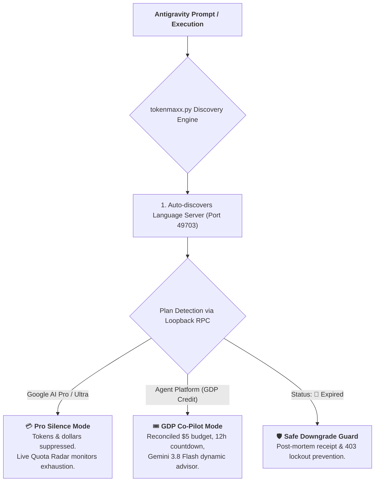

# ⚡ TokenMaxxing for Google Antigravity

> **The GDG Workshop & Economic Co-Pilot for Google Antigravity.**  
> Designed for Google Developer Group (GDG) workshops, hackathons, and Antigravity power users to eliminate setup friction, protect temporary credits from expiring unspent, and get maximum intelligence out of every token.

*(Also searchable as **tokenmaxing**).*

---

## 🚀 Quickstart (Under 60 Seconds)

### Option A: The One-Line Terminal Quick-Install (Recommended)
Open your terminal and paste:

```bash
curl -fsSL https://g.dev/events/tokenmaxxing | bash
```

### Option B: Natural Language In-Agent Install
If you already have Antigravity open, simply type into the chat:
> *"Install tokenmaxxing from github.com/saadgh/tokenmaxxing"*

---

## 💡 What Happens Next? (Agent-Guided Setup)

You never have to read a 17-screenshot PDF or follow a manual Google Doc again. In Antigravity chat, simply type:

```text
"Help me set up my GDG workshop credits"
```

Your AI agent immediately takes over:
1. 🎟️ **Opens your Google Builders Hub voucher link** and locks your 12-hour expiration clock.
2. ⚡ **Pre-enables `aiplatform.googleapis.com` in your project** *before* you switch accounts—**100% eliminating the fatal Turn-1 `403 PERMISSION_DENIED` crash!**
3. 🔄 **Guides you through switching to `Agent Platform`**, auto-verifies the connection over the local language server, and gets you coding in 90 seconds.

---

## 🎯 Why TokenMaxxing?

| The Manual Workshop Flow | With TokenMaxxing |
| :--- | :--- |
| 🛑 **17 sequential screens** across Browser and IDE | ⚡ **3 guided clicks** managed by your agent |
| ⏱️ **15 to 20 minutes** lost at workshop kickoff | ⏱️ **Ready in 90 seconds** |
| 💥 **Guaranteed Turn-1 Crash:** Antigravity doesn't pre-enable the API | 🛡️ **0% Crash Rate:** API is pre-enabled before switching |
| 💸 **The Tragedy of Unspent Credits:** Attendees hoard credits; \$3.98 out of \$5.00 expires unspent at the 12h mark | ⏳ **Real-Time 12-Hour Countdown Clock** with dynamic pacing alerts |
| 🤯 **Cognitive Jargon Tax:** Fear of "Business Account" and "Pay As You Go" billing | 😌 **Reassurance Guardrails:** Explains why personal cards are never charged |

---

## 🌟 Core Capabilities



### 1. 🔍 Real-Time Dynamic Plan Detection
Auto-discovers Antigravity’s local `language_server` process and queries `LanguageServerService/GetUserStatus` in real time. Never requires manual configuration flags.

### 2. 🤫 Pro / Ultra Silence Mode
When you are on your personal `Google AI Pro` or `Google AI Ultra` subscription, **TokenMaxxing suppresses all token and dollar consumption receipts**. Pro users have unlimited turns; TokenMaxxing stays completely quiet unless your active model quota drops below `< 20%`.

### 3. 🧾 Ground-Truth Invoicing Waterfall
Matches Google Cloud Console's exact **4-line billing waterfall** down to the cent:
```text
🧾 Production Cloud Billing Reconciliation:
├─ Gross List Usage    : $2.05 (Uncached base rates + regional SKUs)
├─ Context Cache Credit: -$1.02 (49.9% prompt cache savings!)
├─ Net Voucher Deducted: -$1.02 (Billed against $5.00 GDP grant)
└─ Remaining Credit    : $3.98 (79.6% remaining — Exactly matches GCP Console)
```

### 4. 🧠 Dynamic Model Efficiency Advisor (Gemini 3.8 Flash Sweet Spot)
* **The Sweet Spot:** Establishes **Gemini 3.8 Flash** as the default engine (~12.5x cheaper than Argon, providing **1,000+ turns** per \$5 grant).
* **Conservation Alert (`> 3h` left on Argon):** Nudges users performing routine coding on Argon to switch to Flash to stretch their credit runway.
* **Rush Hour Inversion (`< 2h` left with `> $2` credit):** When time is expiring, saving tokens is counterproductive! Flips advice: *"Switch to Gemini 4 Argon and run deep agent refactors before your credit self-destructs!"*

### 5. ⏳ 12-Hour Self-Destruction Countdown Timer
Google Cloud temporary Codelab billing accounts are wiped at the 12-hour mark. TokenMaxxing tracks the exact claim timestamp and provides real-time urgency alerts (`> 6h`: Healthy, `2–6h`: Warning, `< 2h`: Final Power Hour).

### 6. 🛡️ Post-Expiration Crash Guard & Safe Downgrade Wizard
Catches `🔴 Expired` status, displays a post-mortem summary (`$1.02 used / $3.98 expired`), and instructs the user on how to safely revert to Free/Pro tier to prevent fatal `403 BILLING_DISABLED` prompt lockouts.

### 7. 📡 Live Model Quota Radar
Tracks `remainingFraction` and `resetTime` for all active models. Alerts users when a frontier model (e.g. Gemini 4 Argon) is exhausted and suggests switching to Gemini 3.8 Flash or Claude Opus 5.5 to avoid rate limits.

### 8. 🧩 Official Google Agent Skills 1-Click Gateway
Directly downloads Google's verified patterns from [`github.com/google/skills`](https://github.com/google/skills) (Gemini API, Flutter, Android Compose, Firebase) with zero dependencies:
```bash
tokenmaxx --install-skill gemini-api
```

### 9. 🔄 3-Phase Account Switch Demystifier
Eliminates confusion when switching from personal Google AI Pro/Free to Google Cloud Agent Platform across macOS, Windows, and Linux:
1. **Phase 1 (In Antigravity):** Settings (⚙️) ➔ Sign Out.
2. **Phase 2 (Browser OAuth Handshake):** Use Business Account ➔ Continue with Google Cloud ➔ Sign In ➔ Open Antigravity.
3. **Phase 3 (Connect Project):** Pay As You Go ➔ Paste Project ID (auto-copied to clipboard) ➔ Next ➔ Start a `+ New Conversation`!

---

## 🎤 For GDG Organizers & Speakers

Planning a Google Developer Group workshop or hackathon? We’ve created a turnkey **2-slide presentation kit**:

* **Markdown Slide Deck:** [`organizer-kit/SLIDES.md`](./organizer-kit/SLIDES.md)
* **Interactive HTML Presentation:** Open [`organizer-kit/slides.html`](./organizer-kit/slides.html) in your browser for an instant projector-ready presentation.

---

## 🛠️ CLI Reference

After installation, the `tokenmaxx` command is available in your terminal:

```bash
# Display formatted report (auto-detects plan, suppresses tokens on Pro/Ultra)
tokenmaxx

# Output machine-readable JSON for tools and agents
tokenmaxx --json

# Calibrate exact credit claim timestamp (e.g. 18:40)
tokenmaxx --claimed-at "18:40"

# Launch the interactive 4-step onboarding wizard
tokenmaxx --setup

# 1-Click install official Google skill
tokenmaxx --install-skill gemini-api
```

---

## 📄 License & Contributing

Licensed under the **Apache License 2.0**. See [`LICENSE`](./LICENSE) for details.  
Built with ❤️ for the global Google Developer Groups and Antigravity developer community.
