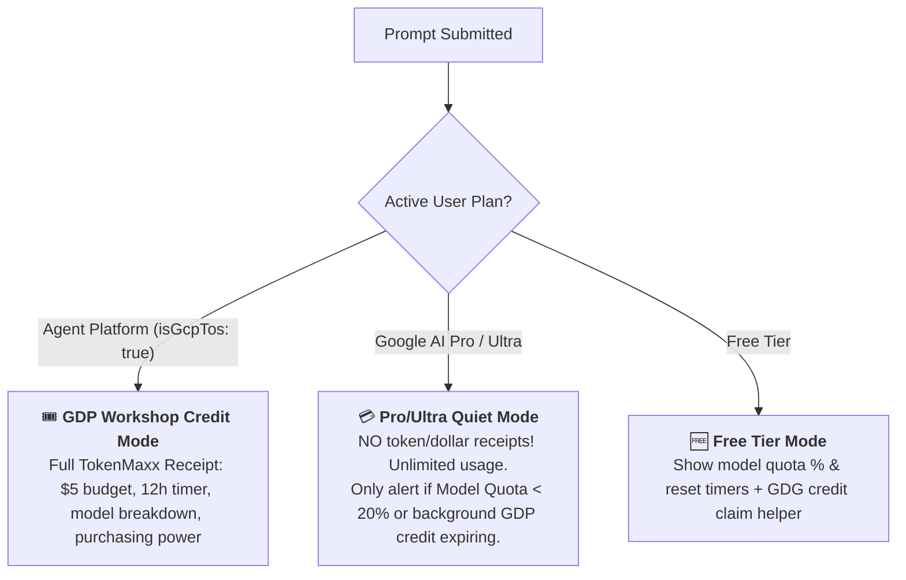

# ⚡ TokenMaxxing for Google Antigravity

**TokenMaxxing** is the GDG Workshop & Economic Co-Pilot for Google Antigravity. It ensures Google Developer Group (GDG) workshop attendees, hackathon participants, and developers get maximum intelligence and runway from every token.

---

## 🎯 Plan-Aware Operational Modes

Before displaying any metrics or receipts, TokenMaxxing identifies the user's active plan by querying Antigravity's local language server loopback RPC (`GetUserStatus` / `GetAuthStatus`) or inspecting `app_storage.json`:



### 1. 🎟️ GDP Workshop Credit Mode (`Agent Platform` / `isGcpTos: true`)
- **Starting Budget:** \$5.00 promotional credit voucher.
- **12-Hour Countdown:** Tracks the strict 12-hour lifespan of the temporary billing account.
- **Cadence — Pulse Every 5 Prompts + Milestone Receipts (`50%`, `70%`, `90%`) + On-Demand:**
  - **Every 5 Prompts (Prompt #1, #5, #10, #15...):** Run `python3 ~/.gemini/config/skills/tokenmaxxing/scripts/tokenmaxx.py --pulse` and append the compact **2-line TokenMaxx Status Bar** (+ Coaching Alert if on Argon or `< 2h` left).
  - **At 50%, 70%, and 90% Budget Used (or `< 2h` remaining):** Automatically display the **Full TokenMaxx Receipt + Coaching Alert**.
  - **On-Demand Natural Language Triggers:** Whenever the user asks *"How much credit and tokens do I have left?"*, *"How much tokens I have left"*, *"How much budget left"*, *"show usage"*, or *"tokenmaxx"*, run `python3 ~/.gemini/config/skills/tokenmaxxing/scripts/tokenmaxx.py` and display the full receipt immediately.
- **Calibrated Multi-Conversation Accounting:** Aggregates tokens across **all** conversations in the active workshop window using `API_PROVIDER_GOOGLE_VERTEX`, accurately pricing Flash vs. Argon.
- **Google Cloud Invoicing Waterfall:**
  ```text
  🧾 Production Cloud Billing Reconciliation:
  ├─ Gross List Usage    : $2.05 (Uncached base rates)
  ├─ Context Cache Credit: -$1.02 (49.9% prompt cache savings!)
  ├─ Net Voucher Deducted: -$1.02 (Billed against $5.00 GDP grant)
  └─ Remaining Credit    : $3.98 (79.6% remaining — Matches GCP Console)
  ```
- **Purchasing Power Translator:** Translates remaining dollars into concrete developer actions (e.g., *"~790 turns on Gemini 3.8 Flash OR ~65 deep refactors on Gemini 4 Argon"*).

### 2. 💳 Personal Subscription Mode (`Google AI Pro` / `Google AI Ultra`)
- **Silence on Tokens & Dollars:** Pro and Ultra users have unlimited subscription usage; **do not clutter their responses with token or dollar consumption receipts.**
- **Model Quota Radar (`< 20%` Guard):** Only surface an alert if their active model quota drops below `< 20%` (e.g., *"⚠️ Gemini 4 Argon quota is exhausted — switch to Gemini 3.8 Flash or Claude Opus 5.5 to avoid throttling"*).
- **Background Credit Notice:** If a temporary 12-hour GDP voucher is still ticking down in the background, provide a subtle 1-line status note so they can switch accounts before it expires.

### 3. 🆓 Free Tier Mode
- Displays live model quotas and reset countdowns.
- Offers direct links to claim \$5.00 GDP credits at Google Developer Group workshops and community events.

---

## 🧠 Dynamic Model Efficiency Advisor (`F18`)

TokenMaxxing establishes **Gemini 3.8 Flash** as the sweet spot for velocity, responsiveness, and token economy:

| Feature | Gemini 3.8 Flash | Gemini 4 Argon (Frontier) |
| :--- | :--- | :--- |
| **Pricing per 1M (In / Cached / Out)** | **\$0.10 / \$0.025 / \$0.40** | **\$1.25 / \$0.3125 / \$5.00** (~12.5x cost) |
| **Runway on \$5 Grant** | **~1,000+ turns** (~50M cached tokens) | **~30 to 50 turns** |
| **Ideal For** | Coding, editing, tests, terminal loops | Multi-file architecture, heavy algorithms |

### Bidirectional Coaching Rules:
1. **Conservation Nudge (`> 3 hours` left on Argon):**
   When the user runs routine coding, bash commands, or simple edits on `gemini-4-argon`, gently suggest:
   > 💡 **Token Efficiency Recommendation:** You are currently using **Gemini 4 Argon** (~12.5x cost multiplier). For routine coding, switch to **Gemini 3.8 Flash** in the model dropdown to preserve your credit runway for 1,000+ turns.
2. **High-Reasoning Confirmation:**
   When multi-file architectural refactoring or security reviews are detected, validate their model selection:
   > 🧠 **High-Reasoning Task:** Deep architecture task detected. Gemini 4 Argon is optimal here.
3. **Rush Hour Burn Inversion (`< 2 hours` left with `> $2.00` unspent):**
   When the 12-hour clock is running out, saving tokens is counterproductive! Invert the guidance:
   > 🔥 **TokenMaxx Burn Opportunity:** You have **1h 45m left** and **\$3.50 unspent credit** before it self-destructs! Switch to **Gemini 4 Argon** and run deep subagents or repository refactors so no free Google compute is wasted!

---

## 🛡️ Post-Expiration Handling & Safe Account Switch (`F16`)

When Google Cloud marks a credit **`🔴 Expired`** at the 12-hour mark:
1. **Post-Mortem Receipt:** Summarizes final usage (e.g. *"\$1.02 utilized \| \$3.98 expired unspent"*).
2. **Account Switch Guard:** Immediately instructs the user to sign out of `Agent Platform` and sign back into their personal Google account (`Google AI Pro` or `Free Tier`) so they can continue chatting seamlessly.

---

## 🚀 Turn-by-Turn Interactive GDP Credit Onboarding (`P0-A`, `P0-B`, `P0-D`)

> [!IMPORTANT]
> **STRICT 1-STEP-AT-A-TIME RULE FOR AI AGENTS:**
> **NEVER dump all 4 onboarding steps in a single message!** And **NEVER** print a placeholder like `<YOUR_PROJECT_ID>`.
> You **MUST** guide the user **one step per turn**, automatically opening the browser page for them via `tokenmaxx.py` and **waiting for their reply** before moving to the next step!

### Turn 1 — Welcome Education + Step 1 (Claim Credit & Version Check)
Run:
```bash
python3 ~/.gemini/config/skills/tokenmaxxing/scripts/tokenmaxx.py --step1
```
*(Note: Only pass a URL argument to `--step1` if the user provided a separate event credit claim link like `https://g.dev/credits/...` — NEVER pass the installer link `https://g.dev/events/tokenmaxxing`!)*
- This automatically checks if the user's Antigravity version is `>= 2.26.0` (warning them to update if older), locks the 12-hour timer, opens their credit link in the browser (with direct `me.developers.google.com` fallback, first-time developer profile tips, and account consistency guidance), and outputs the **Welcome Education + Step 1 prompt**.
- **🛑 STOP & WAIT:** Present ONLY the Step 1 output and wait for the user to paste their link or reply `"claimed"` / `"done"`.

### Turn 2 — Step 2 (Create Google Cloud Project & Select GDP Credit Billing)
Once the user confirms they claimed their credit, run:
```bash
python3 ~/.gemini/config/skills/tokenmaxxing/scripts/tokenmaxx.py --step2
```
- This automatically opens `https://console.cloud.google.com/projectcreate` in their browser and gives them the suggested lowercase Project ID and tip to select `[YYYY-MM-DD] GDP Credit: ...` in the Billing Account dropdown.
- **🛑 STOP & WAIT:** Present ONLY Step 2 and wait for the user to reply with their created **Project ID**.

### Turn 3 — Step 3 (Enable Vertex AI API for Their Real Project ID)
Once the user replies with their `<PROJECT_ID>`, run:
```bash
python3 ~/.gemini/config/skills/tokenmaxxing/scripts/tokenmaxx.py --step3 "<PROJECT_ID>"
```
- This saves `<PROJECT_ID>` to `state.json`, copies it to their clipboard, and automatically opens `https://console.cloud.google.com/apis/enableflow?apiid=aiplatform.googleapis.com&project=<PROJECT_ID>` in their browser.
- **🛑 STOP & WAIT:** Present ONLY Step 3 (with the real pre-filled link) and wait for the user to click **Enable** and reply `"done"`.

### Turn 4 — Step 4 (Dual-UI Account Switch + Final Balance Tracker Hand-Off)
Once the user confirms the API is enabled, run:
```bash
python3 ~/.gemini/config/skills/tokenmaxxing/scripts/tokenmaxx.py --step4
```
- This re-copies their `<PROJECT_ID>` to the clipboard and outputs the 3-Phase Account Switch instructions covering **both Antigravity window layouts**:
  - **Editor (IDE) Window:** Top-right **👤 Profile icon** → **Sign Out**
  - **Agent Manager Window:** Bottom-left **⚙️ Settings** → **Account** → **Sign Out**
- Ends with the **Final Step Hand-Off** teaching the user to open **`+ New Conversation`** and type:
  👉 **`How much credit and tokens do I have left?`**

---

## 🧩 Official Google Agent Skills Gateway (`F15`)

Equip your project with official Google Agent Skills from [`github.com/google/skills`](https://github.com/google/skills) in 1 click (0 installation tokens, zero bloat):
- **Curated Workshop Tracks:**
  - 🔥 **AI & Backend Track (`--install-skill ai`):** `gemini-api` + `firebase-basics`
  - 📱 **Mobile Track (`--install-skill mobile`):** `flutter` + `jetpack-compose-performance`
  - ☁️ **Cloud Track (`--install-skill cloud`):** `cloud-run` + `retrieving-developer-knowledge`
- **1-Click Installation:**
  - Run: `python3 ~/.gemini/config/skills/tokenmaxxing/scripts/tokenmaxx.py --install-skill <name_or_track>`
  - Or simply tell Antigravity in chat: *"Install gemini-api skill"* or *"Install AI skills track"*.

---

## 🔑 Zero-Key Gemini SDK & 1-Prompt Cloud Run Bootstrapper

- **Auto-Inject Workshop `project_id` (`google-genai` SDK):**
  Because `tokenmaxx.py` saves the attendee's Google Cloud `project_id` in `~/.gemini/config/skills/tokenmaxxing/state.json`, whenever the user asks to build a Gemini-powered app, automatically pre-configure the official Google Gen AI SDK (`google-genai`) in Vertex AI mode using their saved `project_id` (`genai.Client(vertexai=True, project="<project_id>", location="global")`). Their app works on the very first run funded by their \$5.00 voucher—with zero API keys to create or leak!
- **1-Prompt Cloud Run Deployment:**
  When the user asks *"Deploy my app to Cloud Run"*, automatically use their saved `project_id` from `state.json` (and the `cloud-run` skill) so they leave the workshop with a live `https://...run.app` URL.
- **Hour 12 Graduation Bridge (`--wrapup`):**
  When the 12-hour credit finishes (or when the user runs `--wrapup`), displays their total Gemini tokens & Context Cache savings and guides them to keep their app running free with **Google AI Studio (`https://aistudio.google.com/apikey`)** or the **\$300 Google Cloud Free Trial (`https://cloud.google.com/free`)**.

---

## 🛠️ CLI Reference

```bash
# Display full TokenMaxx Receipt (auto-detects plan, suppresses tokens on Pro/Ultra)
python3 ~/.gemini/config/skills/tokenmaxxing/scripts/tokenmaxx.py

# Display compact 2-line TokenMaxx Status Bar (for Every-5-Prompts Pulse; auto-escalates at 50%/70%/90%)
python3 ~/.gemini/config/skills/tokenmaxxing/scripts/tokenmaxx.py --pulse

# Display Workshop Impact Summary & Free Gemini/GCP Graduation Bridge
python3 ~/.gemini/config/skills/tokenmaxxing/scripts/tokenmaxx.py --wrapup

# Turn-by-turn onboarding step helpers (auto-opens browser URLs)
python3 ~/.gemini/config/skills/tokenmaxxing/scripts/tokenmaxx.py --step1 "<claim_url>"
python3 ~/.gemini/config/skills/tokenmaxxing/scripts/tokenmaxx.py --step2
python3 ~/.gemini/config/skills/tokenmaxxing/scripts/tokenmaxx.py --step3 "<project_id>"
python3 ~/.gemini/config/skills/tokenmaxxing/scripts/tokenmaxx.py --step4

# Reset workshop session for a fresh $5.00 voucher and 12h clock
python3 ~/.gemini/config/skills/tokenmaxxing/scripts/tokenmaxx.py --reset
```
