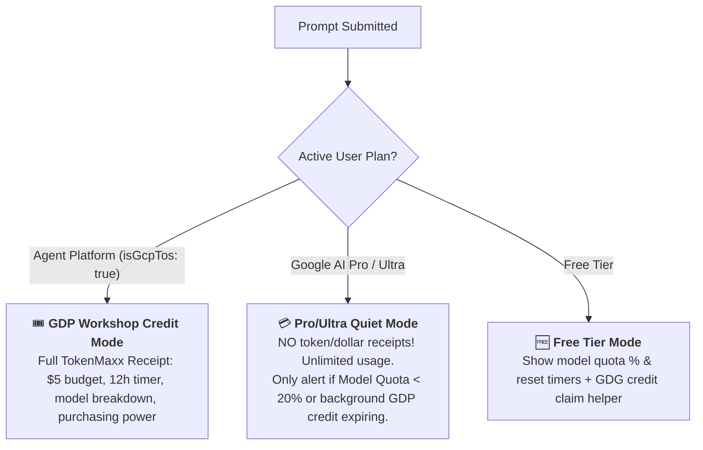

# ⚡ TokenMaxxing for Google Antigravity

**TokenMaxxing** is the economic co-pilot and token management engine for Google Antigravity. It ensures Google Developer Group (GDG) workshop attendees, hackathon participants, and everyday developers get maximum intelligence and runway from every token.

---

## 🎯 Plan-Aware Operational Modes

Before displaying any metrics or receipts, TokenMaxxing identifies the user's active plan by querying Antigravity's local language server loopback RPC (`GetUserStatus` / `GetAuthStatus`) or inspecting `app_storage.json`:



### 1. 🎟️ GDP Workshop Credit Mode (`Agent Platform` / `isGcpTos: true`)
- **Starting Budget:** \$5.00 promotional credit voucher.
- **12-Hour Destruction Countdown:** Tracks the strict 12-hour lifespan of the temporary billing account.
- **Calibrated Multi-Conversation Accounting:** Aggregates tokens across **all** conversations using `API_PROVIDER_GOOGLE_VERTEX`, accurately pricing Flash vs. Argon.
- **Google Cloud Invoicing Waterfall:**
  ```text
  🧾 Production Cloud Billing Reconciliation:
  ├─ Gross List Usage    : $2.05 (Uncached base rates)
  ├─ Context Cache Credit: -$1.02 (49.9% prompt cache savings!)
  ├─ Net Voucher Deducted: -$1.02 (Billed against $5.00 GDP grant)
  └─ Remaining Credit    : $3.98 (79.6% remaining — Matches GCP Console)
  ```
- **Purchasing Power Translator:** Translates remaining dollars into concrete developer actions (e.g., *"~790 turns on Gemini 3.8 Flash OR ~65 deep refactors on Gemini 4 Argon"*).

### 2. 💳 Personal Subscription Mode (`Google AI Pro` / `Google AI Ultra`)
- **Silence on Tokens & Dollars:** Pro and Ultra users have unlimited subscription usage; **do not clutter their responses with token or dollar consumption receipts.**
- **Model Quota Radar (`< 20%` Guard):** Only surface an alert if their active model quota drops below `< 20%` (e.g., *"⚠️ Gemini 4 Argon quota is exhausted — switch to Gemini 3.8 Flash or Claude Opus 5.5 to avoid throttling"*).
- **Background Credit Notice:** If a temporary 12-hour GDP voucher is still ticking down in the background, provide a subtle 1-line status note so they can switch accounts before it expires.

### 3. 🆓 Free Tier Mode
- Displays live model quotas and reset countdowns.
- Offers direct links to claim \$5.00 GDP credits at Google Developer Group workshops and community events.

---

## 🧠 Dynamic Model Efficiency Advisor (`F18`)

TokenMaxxing establishes **Gemini 3.8 Flash** as the sweet spot for velocity, responsiveness, and token economy:

| Feature | Gemini 3.8 Flash | Gemini 4 Argon (Frontier) |
| :--- | :--- | :--- |
| **Pricing per 1M (In / Cached / Out)** | **\$0.10 / \$0.025 / \$0.40** | **\$1.25 / \$0.3125 / \$5.00** (~12.5x cost) |
| **Runway on \$5 Grant** | **~1,000+ turns** (~50M cached tokens) | **~30 to 50 turns** |
| **Ideal For** | Coding, editing, tests, terminal loops | Multi-file architecture, heavy algorithms |

### Bidirectional Coaching Rules:
1. **Conservation Nudge (`> 3 hours` left on Argon):**
   When the user runs routine coding, bash commands, or simple edits on `gemini-4-argon`, gently suggest:
   > 💡 **Token Efficiency Recommendation:** You are currently using **Gemini 4 Argon** (~12.5x cost multiplier). For routine coding, switch to **Gemini 3.8 Flash** in the model dropdown to preserve your credit runway for 1,000+ turns.
2. **High-Reasoning Confirmation:**
   When multi-file architectural refactoring or security reviews are detected, validate their model selection:
   > 🧠 **High-Reasoning Task:** Deep architecture task detected. Gemini 4 Argon is optimal here.
3. **Rush Hour Burn Inversion (`< 2 hours` left with `> $2.00` unspent):**
   When the 12-hour clock is running out, saving tokens is counterproductive! Invert the guidance:
   > 🔥 **TokenMaxx Burn Opportunity:** You have **1h 45m left** and **\$3.50 unspent credit** before it self-destructs! Switch to **Gemini 4 Argon** and run deep subagents or repository refactors so no free Google compute is wasted!

---

## 🛡️ Post-Expiration Handling & Safe Downgrade (`F16`)

When Google Cloud marks a credit **`🔴 Expired`** at the 12-hour mark:
1. **Post-Mortem Receipt:** Summarizes final usage (e.g. *"\$1.02 utilized \| \$3.98 expired unspent"*).
2. **Crash Prevention Guard:** Immediately instructs the user to switch their Antigravity license from `Agent Platform` back to `Google AI Pro` or `Free Tier` to prevent fatal `403 BILLING_DISABLED` prompt lockouts.

---

## 🚀 Interactive GDP Credit Onboarding Wizard (`F13`, `F14`)

Solves the **#1 fatal bug** in legacy workshop documentation where switching to `Agent Platform` *before* enabling the API caused a permanent `403 PERMISSION_DENIED` crash:

1. **Step 1 (Claim Credit):** Opens event claim link; clicking locks exact 12-hour timestamp in `state.json`.
2. **Step 2 (Create Project):** Opens `https://console.cloud.google.com/projectcreate` directly.
3. **Step 3 (Pre-Enable API *Before* Switching!):** Opens `https://console.developers.google.com/apis/api/aiplatform.googleapis.com/overview?project=<id>` *while still on the working account* so the API is live prior to switching.
4. **Step 4 (Switch & Verify):** Guides user to switch to `Agent Platform` and queries `GetUserStatus` to verify active connection.

---

## 🧩 Official Google Agent Skills Gateway (`F15`)

Detects active project frameworks and offers 1-click installation of official skills from [`github.com/google/skills`](https://github.com/google/skills):
- **Detected Tech:** Flutter (`flutter/skills`), Android Compose (`android-profiler`, `jetpack-compose-performance`), Firebase (`firebase-firestore`, `firebase-crashlytics`), Genkit, Gemini API (`gemini-api`, `gemini-live-api`), Cloud Run.
- **1-Click Installation:** Run `python3 ~/.gemini/config/skills/tokenmaxxing/scripts/tokenmaxx.py --install-skill <skill_name>`.

---

## 🛠️ CLI Reference

```bash
# Display formatted report (auto-detects plan, suppresses tokens on Pro/Ultra)
python3 ~/.gemini/config/skills/tokenmaxxing/scripts/tokenmaxx.py

# Machine-readable JSON output for tools and agents
python3 ~/.gemini/config/skills/tokenmaxxing/scripts/tokenmaxx.py --json

# Calibrate exact credit claim timestamp (e.g. 18:40)
python3 ~/.gemini/config/skills/tokenmaxxing/scripts/tokenmaxx.py --claimed-at "18:40"

# 1-Click install official Google skill
python3 ~/.gemini/config/skills/tokenmaxxing/scripts/tokenmaxx.py --install-skill gemini-api

# Launch interactive GDP setup wizard
python3 ~/.gemini/config/skills/tokenmaxxing/scripts/tokenmaxx.py --setup
```
